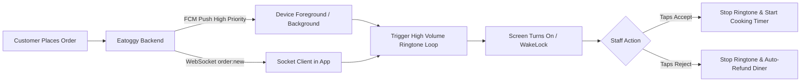
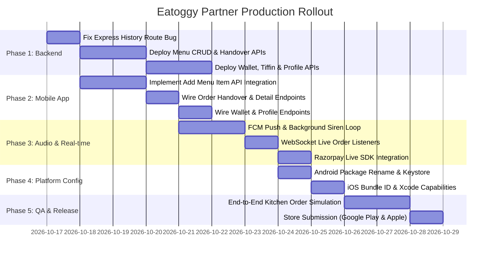

# Eatoggy Restaurant Partner App — Production Checklist & Full App Audit

> **Target Release**: Production Ready (Google Play Store & Apple App Store)  
> **Repository**: `eatoggy-restrourent-partner-app`  
> **App Framework**: Flutter 3.x / Dart (Riverpod, GoRouter, Dio, Sizer)  
> **Base API URL**: `https://api.eatoggy.in/api`  
> **Document Purpose**: Complete audit of all features, missing functions, remaining backend APIs, deep-dive on Menu Item Add API, and production readiness checklist.

---

## 📑 Table of Contents
1. [Deep-Dive Audit: Add Menu Item API & Current Gaps](#1-deep-dive-audit-add-menu-item-api--current-gaps)
2. [Full App Feature Audit — What is Working vs What is Missing](#2-full-app-feature-audit--what-is-working-vs-what-is-missing)
3. [Master Checklist: Remaining Backend APIs Needed](#3-master-checklist-remaining-backend-apis-needed)
4. [Master Checklist: Mobile Client-Side Tasks & Features to Add](#4-master-checklist-mobile-client-side-tasks--features-to-add)
5. [Kitchen Operational Hardening: Audio Siren, Wake-Lock & Push](#5-kitchen-operational-hardening-audio-siren-wake-lock--push)
6. [Platform Release & Store Compliance Checklist (Android & iOS)](#6-platform-release--store-compliance-checklist-android--ios)
7. [Step-by-Step Phase Execution Plan](#7-step-by-step-phase-execution-plan)

---

## 1. Deep-Dive Audit: Add Menu Item API & Current Gaps

### 1.1 Current State in the Flutter App
In `lib/features/menu/presentation/pages/add_menu_item_screen.dart` and `add_menu_item_provider.dart`:
- **UI Form**: The screen collects all necessary dish data:
  - Dish Name (`_nameController`)
  - Base Price (`_priceController`)
  - Cooking / Prep Time in minutes (`_prepTimeController`)
  - Description (`_descriptionController`)
  - Food Type: Veg / Non-Veg toggle (`state.isVeg`)
  - Immediate availability toggle (`state.isAvailable`)
  - Image from Camera or Gallery (`ImagePicker` $\rightarrow$ `state.imagePath`)
  - Portion Variants: e.g., *Half: ₹120, Full: ₹220* (`state.sizeVariants`)
  - Addon Groups: e.g., *Extra Cheese: +₹30, Butter: +₹15* (`state.addons`)
  - Category Selection Dropdown (`state.selectedCategory`)

### 1.2 The Critical Bugs & Discrepancies in the Current Code
1. **No API Call on Save**: In `add_menu_item_screen.dart` (line 377), `_onSaveItem()` merely shows a green SnackBar and pops the screen:
   ```dart
   // ❌ CURRENT FAKE IMPLEMENTATION:
   void _onSaveItem() {
     if (_formKey.currentState?.validate() ?? false) {
       ScaffoldMessenger.of(context).showSnackBar(
         SnackBar(content: Text('Item saved successfully!')),
       );
       context.pop();
     }
   }
   ```
2. **Missing Category ID Mapping**:
   - `add_menu_item_provider.dart` maps categories to a `List<String>` of names:
     `categories.map((c) => c.title).toList()`.
   - The backend database requires the 24-character MongoDB **`categoryId`** (ObjectId), NOT the string name.
   - The state must track both `selectedCategoryId` and `selectedCategoryName`.
3. **No Repository Method**: `MenuRepository` (`lib/features/menu/data/repositories/menu_repository.dart`) only has `getCategories()` and `createCategory()`. It has **no** `createMenuItem()` or `updateMenuItem()` method.
4. **Missing Multipart File Formatting**: The picked image file (`File(state.imagePath)`) is not wrapped as a `dio.MultipartFile`.
5. **No Loading State on Button**: The button does not disable or display a `CircularProgressIndicator` while the dish image is uploading.

---

### 1.3 Exact API Specification Required from Backend

* **Method**: `POST`
* **Path**: `/api/restaurants/menu/items`
* **Auth**: `Bearer <JWT_TOKEN>`
* **Content-Type**: `multipart/form-data`

#### Request Payload Fields:
| Field Name | Type | Required | Example | Notes |
|:---|:---:|:---:|:---|:---|
| `categoryId` | String (ObjectId) | **YES** | `65b4c109df51279401e3e7b5` | MongoDB ObjectId of selected category |
| `itemName` | String | **YES** | `Paneer Butter Masala` | Dish name |
| `price` | Number / String | **YES** | `280` | Base selling price (INR) |
| `description` | String | No | `Rich butter gravy with fresh cottage cheese` | Dish bio / recipe notes |
| `isVeg` | Boolean | **YES** | `true` | `true` = Veg, `false` = Non-Veg |
| `prepTimeMinutes` | Number | **YES** | `20` | Kitchen cooking time in minutes |
| `isAvailableImmediately` | Boolean | No | `true` | Default `true` |
| `sizeVariants` | JSON String / Array | No | `[{"title":"Half","price":150},{"title":"Full","price":280}]` | Portion sizes |
| `addons` | JSON String / Array | No | `[{"title":"Extra Butter","price":25}]` | Addon items |
| `image` | Binary File | No | `dish_image.jpg` | Multipart image file (JPG / PNG) |

#### Backend Expected Success Response (`201 Created`):
```json
{
  "success": true,
  "message": "Menu item created successfully",
  "data": {
    "id": "65b4c901df51279401e3e8a1",
    "restaurantId": "65b3cc6f96d118c6b8704eb9",
    "categoryId": "65b4c109df51279401e3e7b5",
    "itemName": "Paneer Butter Masala",
    "price": 280,
    "isVeg": true,
    "prepTimeMinutes": 20,
    "isAvailableImmediately": true,
    "imageUrl": "https://cdn.eatoggy.in/uploads/menu/paneer.jpg",
    "createdAt": "2026-10-16T12:00:00.000Z"
  }
}
```

---

## 2. Full App Feature Audit — What is Working vs What is Missing

Here is an end-to-end evaluation of every module and screen in the Eatoggy Partner codebase:

### 2.1 Module 1: Auth & Onboarding Flow
| Screen / Feature | Current State | Missing Functionality / Feature Needed |
|:---|:---:|:---|
| **Splash Screen** (`splash_screen.dart`) | ⚠️ Local-only check | Checks local disk only. Needs live `GET /api/restaurants/me` to detect if Admin approved the kitchen from `PENDING_REVIEW` to `APPROVED`. |
| **Login & OTP** (`login_screen.dart`, `otp_screen.dart`) | ✅ Fully Working | SMS OTP & verify OTP work with JWT storage. |
| **Business Details** (`business_profile_screen.dart`) | ✅ Fully Working | Address, cuisine, timings synced via `PUT /api/restaurant-onboarding/business-details`. |
| **Document Upload** (`verify_documents_screen.dart`) | ✅ Fully Working | GST certificate & FSSAI food license upload working via multipart. |
| **Identity & Bank** (`identity_bank_screen.dart`) | ✅ Fully Working | Aadhaar front/back and bank account details synced via multipart. |
| **Kitchen Hygiene Step** (`kitchen_hygiene_screen.dart`) | ✅ Fully Working | Photos of main prep, fridge, and dishwashing uploaded to onboarding endpoint. |
| **Registration Fee Payment** (`review_application_screen.dart`) | ⚠️ **Mock Payment** | Bypasses Razorpay using hardcoded `demo_pay_` ID. Must integrate real Razorpay Flutter SDK checkout for production. |
| **Application Submitted** (`application_submitted_screen.dart`) | ✅ Fully Working | Displays pending review state. |

---

### 2.2 Module 2: Home & Operations Dashboard
| Screen / Feature | Current State | Missing Functionality / Feature Needed |
|:---|:---:|:---|
| **Online / Offline Switch** | ⚠️ Local State Only | Toggling the switch only changes memory state. Needs backend call `PATCH /api/restaurants/status/toggle-online` with reason dialog (e.g. *Kitchen Rush*, *Break*, *Closed*). |
| **Dashboard Metrics** | ✅ Connected | Pulls live metrics from `GET /api/restaurants/dashboard` & `/analytics/overview`. |
| **Recent Orders Widget** | ✅ Connected | Pulls top 5 orders from active kitchen queue. |
| **Quick Action Shortcuts** | ⚠️ Needs Wiring | Shortcuts like *Emergency Pause (30m / 1 hr)* should trigger auto-offline timers. |

---

### 2.3 Module 3: Kitchen & Live Order Execution
| Screen / Feature | Current State | Missing Functionality / Feature Needed |
|:---|:---:|:---|
| **Kitchen Queue Screen** (`kitchen_screen.dart`) | ✅ Working | Fetches live queue from `GET /api/restaurants/kitchen/orders`. |
| **Incoming Order Ringtone / Siren** | ❌ **Completely Missing** | Kitchen staff cannot hear incoming orders! Need high-volume continuous sound loop until staff interacts with screen. |
| **Wake Screen / Full-Screen Intent** | ❌ **Missing** | Device screen should automatically wake up when an incoming order arrives. |
| **Order Detail Screen** (`order_detail_screen.dart`) | ⚠️ Partial Fallback | Uses summary card items because `GET /api/restaurants/orders/:orderId` was missing on backend. Needs real detailed bill breakdown. |
| **Accept Order with Timer** | ✅ Working | Calls `POST /api/restaurants/orders/:id/accept` with estimated cooking time (20/30 mins). |
| **Start Cooking / Mark Preparing** | ✅ Working | Transitions order status to `PREPARING`. |
| **Mark Ready for Pickup** | ✅ Working | Transitions order status to `READY`. |
| **Order Rejection Modal** | ✅ Working UI | Selects reason (`OUT_OF_STOCK`, `KITCHEN_BUSY`) and calls `POST /api/restaurants/orders/:id/reject`. |
| **Rider Pickup Handover** (`handover_order_screen.dart`) | ⚠️ Local State Only | "Done" button only marks local state. Needs real backend call `POST /api/restaurants/orders/:orderId/handover` with rider verification OTP. |
| **Past Orders / History Tab** (`orders_screen.dart`) | ❌ **Backend Blocked** | Endpoint `GET /api/restaurants/orders/history` crashes on backend due to Express route order bug. |

---

### 2.4 Module 4: Menu Management
| Screen / Feature | Current State | Missing Functionality / Feature Needed |
|:---|:---:|:---|
| **Categories List** (`menu_screen.dart`) | ✅ Working | Fetches categories from `GET /api/restaurants/menu/categories`. |
| **Add Category Modal** (`add_category_screen.dart`) | ✅ Working | Posts new category via `POST /api/restaurants/menu/categories`. |
| **Category Items Screen** (`category_items_screen.dart`) | ❌ **Hardcoded Dummy** | Uses `CategoryItemsModel.dummy`. Must fetch real items via `GET /api/restaurants/menu/categories/:id/items`. |
| **Add Menu Item Screen** (`add_menu_item_screen.dart`) | ❌ **No API Call** | Form collects data but does not submit to backend. Must call `POST /api/restaurants/menu/items`. |
| **Edit Menu Item Screen** | ❌ **No API Call** | Save changes does not call `PUT /api/restaurants/menu/items/:id`. |
| **In-Stock / Out-of-Stock Switch** | ⚠️ Local State Only | Must call `PATCH /api/restaurants/menu/items/:id/toggle-stock` to sync with diner app in real-time. |
| **Delete Dish** | ❌ **Missing** | No delete option or backend integration for `DELETE /api/restaurants/menu/items/:id`. |

---

### 2.5 Module 5: Subscriptions & Tiffin Operations
| Screen / Feature | Current State | Missing Functionality / Feature Needed |
|:---|:---:|:---|
| **Subscription Plans Screen** (`subscriptions_plans_screen.dart`) | ✅ Working | Lists tiffin plans from `GET /api/restaurants/tiffin-plans`. |
| **Create Tiffin Plan** (`create_tiffin_plan_screen.dart`) | ✅ Working | Creates plans via `POST /api/restaurants/tiffin-plans`. |
| **Manage / Pause Plan** (`manage_tiffin_plan_screen.dart`) | ⚠️ Local Simulation | Toggle plan status does not call `PUT /api/restaurants/tiffin-plans/:planId`. |
| **Today's Tiffin Deliveries** (`tiffin_deliveries_screen.dart`) | ❌ **Hardcoded Dummy** | Today's Lunch/Dinner dispatch batches show dummy subscribers. Must fetch `GET /api/restaurants/tiffin-plans/deliveries/today`. |
| **Subscriber Card Screen** (`subscriber_card_screen.dart`) | ⚠️ Local Mock | Customer subscription history and pause requests need backend sync. |

---

### 2.6 Module 6: Earnings, Settlements & Wallet
| Screen / Feature | Current State | Missing Functionality / Feature Needed |
|:---|:---:|:---|
| **Wallet Overview** (`wallet_screen.dart`) | ✅ Working | Pulls available balance & pending payouts from `GET /api/restaurants/wallet`. |
| **Transactions List** (`transactions_screen.dart`) | ✅ Working | Pulls live paginated ledger from `GET /api/restaurants/wallet/transactions`. |
| **Request Withdrawal Modal** | ⚠️ Local Simulation | Creates fake transaction in local memory. Must call `POST /api/restaurants/wallet/withdraw`. |
| **Revenue Earnings Screen** (`revenue_earnings_screen.dart`) | ✅ Working | Pulls settlement history from `GET /api/restaurants/earnings`. |
| **GST / Invoice Download** | ❌ **Feature Needed** | Kitchens need PDF download for monthly settlement GST tax invoices. |

---

### 2.7 Module 7: Kitchen Profile & Business Tools
| Screen / Feature | Current State | Missing Functionality / Feature Needed |
|:---|:---:|:---|
| **Kitchen Profile Screen** (`kitchen_profile_screen.dart`) | ✅ Working | Pulls profile from `GET /api/restaurants/profile`. |
| **Edit Profile Screen** (`edit_profile_screen.dart`) | ⚠️ Local Delay | `saveChanges()` uses `Future.delayed(500ms)`. Must call `PUT /api/restaurants/profile`. |
| **Bank Account Details Screen** | ⚠️ Local Simulation | Displays masked account. Updating account details only delays 500ms without backend verification. |
| **Tax Information Screen** (`tax_information_screen.dart`) | ⚠️ Local Simulation | GSTIN and PAN edits are simulated. |
| **Thermal Receipt Printer** (`thermal_printer_screen.dart`) | ⚠️ Mock Simulator | UI test receipt works in preview. Needs real ESC/POS Bluetooth plugin (e.g. `blue_thermal_printer` or `flutter_pos_printer_platform`) for kitchen KOT printing. |

---

### 2.8 Module 8: Notifications, Sockets & Support
| Screen / Feature | Current State | Missing Functionality / Feature Needed |
|:---|:---:|:---|
| **Notifications Screen** (`notifications_screen.dart`) | ✅ Working | Fetches notifications and calls `PATCH /api/restaurants/notifications/mark-read`. |
| **Push Notification Service** (`notification_service.dart`) | ❌ **Commented Out** | Firebase Messaging and local notifications are commented out. |
| **Device Token Service** (`device_token_service.dart`) | ⚠️ Generates Fake Token | Generates dummy string timestamp because FCM is not initialized. |
| **WebSocket Real-time Client** (`socket_service.dart`) | ❌ **Commented Out** | Has commented-out taxi events. Needs restaurant order events (`order:new`, `order:cancelled`, `rider:assigned`). |
| **Customer Reviews** (`ratings_and_reviews_screen.dart`) | ✅ Working | Fetches reviews from `GET /api/restaurants/reviews`. |
| **Reply to Review** (`respond_to_review_screen.dart`) | ✅ Working | Posts partner reply via `POST /api/restaurants/reviews/:id/reply`. |
| **Help & Support** (`help_support_screen.dart`) | ✅ Working | Fetches tickets and creates new tickets via `POST /api/support/tickets`. |

---

## 3. Master Checklist: Remaining Backend APIs Needed

### 3.1 Urgent Bug Fix
- [ ] **Express Router Fix**: In the backend orders route file, move:
  ```javascript
  router.get('/orders/history', authMiddleware, getOrderHistory);
  ```
  **above** the route:
  ```javascript
  router.get('/orders/:orderId', authMiddleware, getOrderDetails);
  ```
  *(Prevents Express from parsing `"history"` as a MongoDB ObjectId).*

### 3.2 High-Priority (P1) Core Endpoints to Deploy
- [ ] `GET /api/restaurants/me` — Auto-login session validation & onboarding approval status.
- [ ] `PATCH /api/restaurants/status/toggle-online` — Store Online / Offline operational toggle.
- [ ] `GET /api/restaurants/orders/:orderId` — Complete order line-items, custom notes, customer details, and tax breakdown.
- [ ] `POST /api/restaurants/orders/:orderId/handover` — Delivery partner OTP verification and dispatch confirmation.
- [ ] `POST /api/restaurants/orders/:orderId/reject` — Reject incoming order with rejection reason code & auto-refund.
- [ ] `GET /api/restaurants/menu/categories/:categoryId/items` — Fetch dishes belonging to a category.
- [ ] `POST /api/restaurants/menu/items` — Add new dish with photo, variants, and addons (Multipart).
- [ ] `PUT /api/restaurants/menu/items/:itemId` — Edit dish price, description, prep time, and variants.
- [ ] `PATCH /api/restaurants/menu/items/:itemId/toggle-stock` — Instant toggle for In-Stock (true) vs Out-of-Stock (false).
- [ ] `DELETE /api/restaurants/menu/items/:itemId` — Remove dish from menu.
- [ ] `POST /api/restaurants/notifications/device-token` — Register FCM device push token for sound chime.

### 3.3 Medium-Priority (P2) Operations Endpoints to Deploy
- [ ] `GET /api/restaurants/tiffin-plans/deliveries/today` — Scheduled lunch & dinner deliveries for today.
- [ ] `PUT /api/restaurants/tiffin-plans/:planId` — Pause, resume, or edit subscription plan.
- [ ] `POST /api/restaurants/wallet/withdraw` — Request withdrawal of available balance to registered bank.
- [ ] `PUT /api/restaurants/profile` — Update kitchen bio, operating hours, break times, and banner.
- [ ] `PATCH /api/restaurants/notifications/mark-read` — Mark notification(s) as read.

---

## 4. Master Checklist: Mobile Client-Side Tasks & Features to Add

### 4.1 Menu Item Add & Edit Implementation
- [ ] Update `MenuCategoryItem` state in `add_menu_item_provider.dart` to store both `categoryId` (ObjectId) and `categoryTitle`.
- [ ] Implement `createMenuItem()` in `lib/features/menu/data/repositories/menu_repository.dart` using Dio `FormData`:
  - Attach image file as `MultipartFile.fromFile(imagePath)`.
  - Format `sizeVariants` and `addons` as JSON strings.
  - Send `POST` to `ApiConstants.menuItems`.
- [ ] Implement `updateMenuItem()` in `MenuRepository` sending `PUT` to `ApiConstants.menuItemDetail(itemId)`.
- [ ] Update `_onSaveItem()` in `add_menu_item_screen.dart` to call the notifier, show progress indicator on the button, and handle errors.
- [ ] Connect `category_items_provider.dart` to fetch real items from `MenuRepository.getItemsByCategory(categoryId)`.
- [ ] Connect stock switch in `MenuItemCard` to `MenuRepository.toggleItemStock(itemId, isAvailable)`.

### 4.2 Order Lifecycle & Handover Wiring
- [ ] Connect `handover_order_screen.dart` "Done" button to call `POST /api/restaurants/orders/:orderId/handover`.
- [ ] Connect `order_detail_provider.dart` to call `GET /api/restaurants/orders/:orderId` for rich order line items.
- [ ] Update `orders_page_provider.dart` to fetch past orders from `GET /api/restaurants/orders/history` for the *Completed* tab.

### 4.3 Wallet, Profile & Auto-Login Wiring
- [ ] Connect `requestWithdrawal()` in `wallet_provider.dart` to call `POST /api/restaurants/wallet/withdraw`.
- [ ] Connect `saveChanges()` in `edit_profile_provider.dart` to call `PUT /api/restaurants/profile`.
- [ ] Connect online/offline switch in `home_provider.dart` and `kitchen_provider.dart` to call `PATCH /api/restaurants/status/toggle-online`.
- [ ] Update `initSplash()` in `splash_provider.dart` to call `GET /api/restaurants/me` dynamically.
- [ ] Fix legacy check in `lib/core/services/api_service.dart` line 91:
  - Replace `/customer/auth/refresh-token` with `/restaurant-auth/refresh-token`.

---

## 5. Kitchen Operational Hardening: Audio Siren, Wake-Lock & Push

In commercial kitchens, staff members do not constantly look at the phone screen. If an order comes in quietly, it will be missed, resulting in order cancellations and lost revenue.

### 5.1 Required Audio Siren Architecture


### 5.2 Implementation Steps
- [ ] Add packages to `pubspec.yaml`:
  ```yaml
  firebase_core: ^3.12.1
  firebase_messaging: ^15.2.4
  flutter_local_notifications: ^18.0.1
  audioplayers: ^6.1.2
  wakelock_plus: ^1.2.10
  socket_io_client: ^3.0.2
  ```
- [ ] Create `assets/sounds/order_siren.mp3` (loud repetitive chime/bell).
- [ ] Configure Android Notification Channel with `Importance.max`, `playSound: true`, `enableVibration: true`, and custom sound URI.
- [ ] Implement `SoundAlertService`:
  - `playOrderAlarm()`: Repeats audio on maximum stream volume and acquires `WakelockPlus.enable()`.
  - `stopAlarm()`: Stops audio and releases wake lock.
- [ ] Un-comment and update `SocketService` to connect to `https://api.eatoggy.in` with JWT Bearer auth and listen to:
  - `order:new`
  - `order:cancelled`
  - `rider:assigned`

---

## 6. Platform Release & Store Compliance Checklist (Android & iOS)

### 6.1 Android Checklist
- [ ] **Package Name**: Update from `com.example.restrorent_partner_app` to a production identifier (e.g. `in.eatoggy.partner`) in:
  - `android/app/build.gradle.kts` (`namespace` & `applicationId`)
  - `android/app/src/main/AndroidManifest.xml`
  - Kotlin package folder hierarchy (`android/app/src/main/kotlin/...`)
- [ ] **App Name Typo Fix**: In `AndroidManifest.xml`, change:
  - `android:label="Eatoggy Restrorent"` $\rightarrow$ `android:label="Eatoggy Partner"`.
- [ ] **Android Permissions**: Add to `AndroidManifest.xml`:
  ```xml
  <uses-permission android:name="android.permission.INTERNET" />
  <uses-permission android:name="android.permission.POST_NOTIFICATIONS" />
  <uses-permission android:name="android.permission.WAKE_LOCK" />
  <uses-permission android:name="android.permission.VIBRATE" />
  <uses-permission android:name="android.permission.FOREGROUND_SERVICE" />
  <uses-permission android:name="android.permission.FOREGROUND_SERVICE_MEDIA_PLAYBACK" />
  <uses-permission android:name="android.permission.CAMERA" />
  <uses-permission android:name="android.permission.READ_MEDIA_IMAGES" />
  ```
- [ ] **Release Signing**:
  - Generate upload keystore: `keytool -genkey -v -keystore upload-keystore.jks ...`
  - Create `android/key.properties` with keystore password and alias.
  - Wire signing configs in `android/app/build.gradle.kts` for `buildTypes.release`.
- [ ] **ProGuard / R8 Rules**: Create `android/app/proguard-rules.pro` to keep Dio, Riverpod, and model classes.
- [ ] **Firebase**: Place production `google-services.json` inside `android/app/`.

### 6.2 iOS Checklist
- [ ] **Bundle Identifier**: Set `in.eatoggy.partner` in Xcode project settings.
- [ ] **App Display Name Typo Fix**: In `ios/Runner/Info.plist`, change:
  - `<string>Restrorent Partner App</string>` $\rightarrow$ `<string>Eatoggy Partner</string>`.
- [ ] **Capabilities in Xcode**:
  - Enable **Push Notifications**.
  - Enable **Background Modes** (`Remote notifications`, `Background fetch`, `Audio, AirPlay`).
- [ ] **Privacy Strings in `Info.plist`**:
  - `NSCameraUsageDescription`: *"Eatoggy Partner requires camera access to photograph kitchen prep areas and dishes."*
  - `NSPhotoLibraryUsageDescription`: *"Eatoggy Partner requires photo library access to upload dish images and business licenses."*
- [ ] **Firebase**: Place production `GoogleService-Info.plist` in `ios/Runner/`.

---

## 7. Step-by-Step Phase Execution Plan



### 🗓️ Phase 1: Backend API Delivery (Days 1–3)
1. Backend team moves `/orders/history` before `/orders/:orderId`.
2. Backend team deploys `POST /api/restaurants/menu/items`, `GET /items`, `PUT /items/:id`, and `PATCH /toggle-stock`.
3. Backend team deploys `POST /handover`, `PATCH /status/toggle-online`, and `POST /wallet/withdraw`.

### 🗓️ Phase 2: Mobile App API Wiring (Days 4–5)
1. Add `createMenuItem` and `updateMenuItem` methods to `MenuRepository`.
2. Update `add_menu_item_provider.dart` to send multipart FormData.
3. Replace hardcoded mock lists in `category_items_provider.dart`.
4. Connect Handover, Order Details, Wallet Withdraw, and Profile Update.

### 🗓️ Phase 3: Loud Audio Alerts, WebSockets & Payments (Days 6–7)
1. Enable Firebase Messaging and configure `SoundAlertService` with looping siren.
2. Enable WebSocket connection on login with `order:new` listener.
3. Integrate `razorpay_flutter` for real onboarding fee collection.

### 🗓️ Phase 4: Platform Engineering & Hardening (Days 8–9)
1. Rename package to `in.eatoggy.partner` on Android and iOS.
2. Fix all typos (`Restrorent` $\rightarrow$ `Restaurant` / `Partner`).
3. Generate production upload keystores and configure `build.gradle.kts` release signing.
4. Add Firebase configuration files.

### 🗓️ Phase 5: Testing & Store Submission (Days 10–12)
1. Run end-to-end kitchen simulation: Order placement $\rightarrow$ Audio bell ringing $\rightarrow$ Accept $\rightarrow$ Cooking $\rightarrow$ Ready $\rightarrow$ Rider OTP Handover.
2. Build release bundle: `flutter build appbundle --release`.
3. Build iOS release: `flutter build ipa --release`.
4. Upload to Google Play Console (Closed Testing) and Apple App Store Connect (TestFlight).
